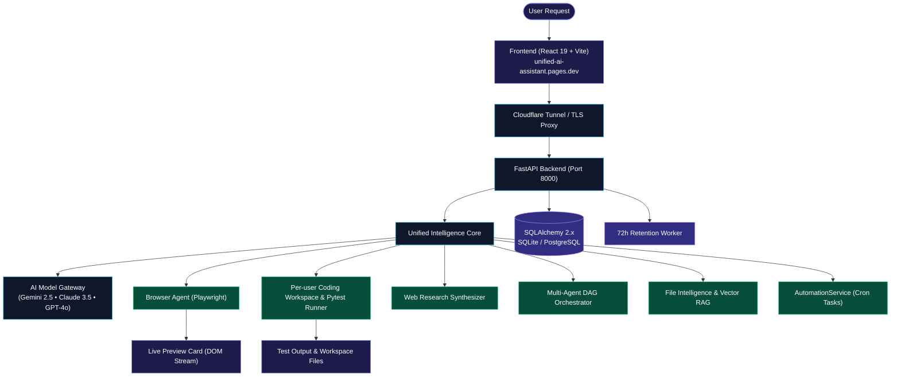

<div align="center">

# 🌌 UNIFIED AI ASSISTANT
### Multi-Provider AI Assistant & Computer-Use Workspace

[](https://unified-ai-assistant.pages.dev)
[](https://github.com/shivampatilck-1010/unified-ai-assistant)
[](https://github.com/shivampatilck-1010)
[](LICENSE)

<br/>

<a href="https://unified-ai-assistant.pages.dev">
  
</a>

<p align="center">
  <b>A multi-provider AI assistant with browser automation, document research, and a review-first coding workspace.</b>
</p>

```
Understand ➔ Plan ➔ Observe ➔ Act ➔ Verify ➔ Recover ➔ Complete
```

<p align="center">
  <a href="#-quick-links">Quick Links</a> •
  <a href="#-key-features">Key Features</a> •
  <a href="#-system-architecture">Architecture</a> •
  <a href="#production-deployment-docker-compose">Production Deployment</a> •
  <a href="#-local-development">Local Setup</a> •
  <a href="#-automated-test-coverage-overview">Test Coverage</a>
</p>

---

</div>

## 🌐 Project Links

| Component | Target URL | Operational Status |
| :--- | :--- | :--- |
| **Web preview** | [unified-ai-assistant.pages.dev](https://unified-ai-assistant.pages.dev) | Check web and API availability independently |
| **Source code** | [shivampatilck-1010/unified-ai-assistant](https://github.com/shivampatilck-1010/unified-ai-assistant) | Repository |
| **API** | Configured by the deployment operator | FastAPI; production requires PostgreSQL and explicit secrets |

---

##  Highlights & Capabilities

### 1.  Executive 3D Metallic Identity & Micro-Animations
* **Sculpted 3D Metallic 'U'**: Pure titanium gunmetal and polished platinum-chrome gradients with authentic specular bevels.
* **Planetary Orbital Plasma Ring**: Perspective-tilted orbital ring with 3D depth layering (passes behind the left arm and loops across the front bowl).
* **Fluid Specular Sheen Sweep**: Animated directional beam of light sweeping smoothly across the metallic creases of the letter.
* **Traveling Photon Particle**: Celestial star particle dynamically tracing the elliptical planetary orbit.
* **Zero Compression Artifacts**: High-resolution 1024x1024 native alpha-transparent PNG and scalable vector SVG (`/logo.svg`).

### 2.  Universal Computer-Use & Autonomous Browser Intelligence (Phase 3)
* **Playwright-Powered Web Execution**: Operates unfamiliar web interfaces, fills forms, authenticates, and completes complex adaptive educational lessons end-to-end.
* **Visual DOM Observation**: Real-time perception of interactive elements, input fields, modals, and dynamic overlays.
* **Live Viewport Card**: Interactive in-chat preview card with live screenshot feed, observed action progress, and fullscreen view.
* **Self-Correction & Recovery**: Automatically detects validation failures, overlays, or navigation timeouts, recovers state, and verifies task completion.

### 3.  Coding Workspace & Review Flow (Phase 4)
* **Private per-user workspace**: coding routes require a verified session and operate only within the signed-in user's workspace.
* **Review-first edits**: preview a unified diff, then explicitly apply it; stale previews are rejected if the source changed.
* **Bounded pytest runner**: runs pytest without a shell, accepts a workspace-relative target, and enforces a timeout.
* **Execution warning**: production disables pytest by default (`ENABLE_CODING_TESTS=false`). When enabled, tests run with the API service account's OS permissions; this is not a hardened container sandbox, so enable only for trusted users.
* **Dedicated Workspace UI**: Integrated directly into the **Projects & Workspaces** view under the *Coding Workspace* tab.

### 4.  Mathematical Notation & Visual Diagrams
* **KaTeX 0.19 Rendering**: Full rendering of inline equations (`$E = mc^2$`, `\(...\)`) and standalone display equation blocks (`$$...$$`, `\[...\]`).
* **Mermaid 12.2 Interactive Diagrams**: Live generation of flowcharts, sequence diagrams, class models, state machines, and Gantt charts with one-click **SVG Download** and code copying.

### 5.  Interactive Canvas Animation
* **Image Generating Particle Canvas**: Pitch-black canvas (`#050507`) with 75 floating gray ambient particles.
* **Interactive Physics**: Particles actively respond to cursor movement with dynamic gravitational attraction and connecting velocity tracer filaments.

### 6. 📂 Document Intelligence & Hybrid RAG (Phase 5)
* **Multi-Format Ingestion**: Supports PDF, DOCX, TXT, Markdown, CSV, and JSON with SHA-256 deduplication and private storage isolation.
* **Semantic Vector Embeddings**: Cosine similarity retrieval with lexical fallback.
* **Grounded Citation Badges**: Verifiable source tags (`[Doc: filename, Page X]`) with snippet previews.

### 7.  Autonomous Web Research Engine (Phase 6)
* **Multi-Query Synthesis**: Formulates deep search plans across independent sources.
* **SSRF-Protected Content Extraction**: Blocks private IP addresses and cloud metadata endpoints (`169.254.169.254`).
* **Structured Markdown Reports**: Automated synthesis with numbered web citations (`[Web N: Title]`).

### 8.  Multi-Agent Orchestration Engine (Phase 7)
* **Directed Acyclic Graph (DAG)**: Orchestrates specialized sub-agents (Planner, Web Researcher, Browser Automator, Coding Agent, Verifier).
* **Human-in-the-Loop Review**: Mandatory confirmation gates for consequential actions.
* **Topological Dependency Execution**: Safe concurrent execution of independent tasks via `asyncio.gather`.

### 9.  Scheduled Automations & 72-Hour Data Retention (Phase 8)
* **Recurring Background Automations**: Built-in cron scheduler for recurring research briefs, browser workflows, and code audits.
* **Automations Manager UI**: Dedicated management tab inside **Calendar & Tasks** to register and monitor active schedules.
* **72-Hour Data Retention**: Automated rolling cleanup worker purging expired conversations, files, and sensing events, with one-click manual purge in **Settings**.

### 10.  Google Authentication & Follow-Up Email Recaps
* **Google Identity Services sign-in**: Google ID tokens are verified server-side against the configured client ID before issuing HMAC-SHA256 application sessions.
* **Follow-Up Email Dispatch**: In-chat modal enabling users to receive concise task summaries, action items, and attachments sent directly to their Google email account.

### 11.  Physical Wi-Fi Sensing Workspace
* **ESP32 CSI Hardware Bridge**: Real serial interface (`COM7` @ 921600 baud) for channel state information (CSI) vital sensing and presence detection.
* **Interactive 3D Room Canvas**: Three.js/Cytoscape room visualization tracking indoor position, respiration rate, and motion vectors.

---

##  System Architecture



---

## Production Deployment (Docker Compose)

The supported self-hosted stack is the repository's Docker Compose deployment: PostgreSQL, API, browser worker, and Nginx. The API and database are on a private Docker network; expose the web service through a trusted TLS-terminating reverse proxy. The Compose Nginx service listens on HTTP port 80 only.

1. Copy `.env.production.example` to `.env.production`. Set a random `JWT_SECRET_KEY` (at least 32 characters), a URL-safe `POSTGRES_PASSWORD`, a PostgreSQL `DATABASE_URL` pointing to `db:5432`, a Google OAuth client ID, and any model provider keys. Never use the example values as production secrets.
2. Set `CORS_ORIGINS` to the exact public web origin. The Google OAuth client ID is public configuration; it is passed to the web build as `VITE_GOOGLE_CLIENT_ID` and also configured server-side as `GOOGLE_CLIENT_ID`.
3. Validate interpolation and required variables before starting:

   ```powershell
   docker compose --env-file .env.production -f docker-compose.prod.yml config
   docker compose --env-file .env.production -f docker-compose.prod.yml up --build -d
   ```

4. Verify the API through the web proxy at `http://localhost/health` and `http://localhost/ready`. Configure TLS on a trusted reverse proxy or Cloudflare in front of this service; do not expose API port 8000 or PostgreSQL port 5432 publicly.

The named volumes preserve PostgreSQL and uploaded/workspace files. Back them up and test restore procedures. The `render.yaml` file is an API-only deployment example; configure its external PostgreSQL URL and durable storage before using it for production. Production code execution is disabled by default; enabling `ENABLE_CODING_TESTS` runs user-supplied pytest code with the API service account's OS permissions, not inside an OS sandbox. A temporary `trycloudflare.com` tunnel and local SQLite are for development, not production.

### Cloudflare Workers deployment

The Workers deployment serves the frontend and handles Google sign-in and per-user coding workspaces at the edge. Coding workspace files are stored in the `unified-ai-assistant-prod-db` D1 database. The Worker does not run user code; test execution always remains disabled because a Worker is not an OS-level sandbox. This deployment does not run the separate Python API or make its other endpoints available.

1. Configure a Google OAuth web client with `https://unified-ai-assistant.cortexbuild1.workers.dev` as an authorized JavaScript origin. Set its client ID as `VITE_GOOGLE_CLIENT_ID` for the frontend build and as the Worker secret `GOOGLE_CLIENT_ID`.
2. Set the Worker secrets before deployment with `npx wrangler secret put GOOGLE_CLIENT_ID` and `npx wrangler secret put JWT_SECRET_KEY`. Use a random signing secret of at least 32 characters; do not commit it or put it in frontend variables.
3. Set `VITE_GOOGLE_CLIENT_ID` in the build environment, apply the D1 schema, build, and deploy:

   ```powershell
   $env:VITE_GOOGLE_CLIENT_ID = "<Google OAuth client ID>"
   npx wrangler d1 migrations apply unified-ai-assistant-prod-db --remote
   Set-Location apps/web
   npm ci
   npm run build
   Set-Location ../..
   npx wrangler deploy --keep-vars
   ```

For Cloudflare Pages as a separate frontend, use `apps/web` as the build root, `npm ci && npm run build` as the build command, and `dist` as the output directory. Set `VITE_API_BASE_URL` to the public API origin and `VITE_GOOGLE_CLIENT_ID` to the configured OAuth client ID. Configure matching CORS origins on the API.

---

## 💻 Local Development Quickstart

### Prerequisites
* **Node.js**: v20.19+ (or v22.12+)
* **Python**: 3.11 or 3.12
* **Git**

### Installation

Clone the repository, then create the backend environment from its root:

```bash
git clone https://github.com/shivampatilck-1010/unified-ai-assistant.git
cd unified-ai-assistant
cd services/api
python -m venv .venv

# Activate on Windows:
.venv\Scripts\activate
# Activate on macOS/Linux:
# source .venv/bin/activate

pip install -r requirements.txt
playwright install chromium
```

Start the backend and frontend in separate terminals, each opened at the repository root:

```bash
# Terminal 1
cd services/api
python -m uvicorn main:app --reload --host 127.0.0.1 --port 8000
```

```bash
# Terminal 2
cd apps/web
npm ci
npm run dev
```
Open **`http://localhost:5173`** in your browser.

To enable Google sign-in locally, configure `JWT_SECRET_KEY` and `GOOGLE_CLIENT_ID` for the API, then set `VITE_GOOGLE_CLIENT_ID` in `apps/web/.env.local` to the same OAuth client ID. Coding workspaces are server-side and scoped per user. Local development enables pytest; it executes code with the API process's OS permissions, so only run trusted code.

---

## 📊 Automated Test Coverage Overview

| Subsystem | Milestone | Test Method | Repository evidence |
| :--- | :--- | :--- | :--- |
| **Model Gateway** | Phase 1 & 2 | Multi-model streaming SSE | `tests/test_model_gateway.py`, `tests/test_streaming.py` |
| **KaTeX / Mermaid** | Phase 2 | Math rendering and diagram UI | Frontend build; verify in browser |
| **Browser Agent** | Phase 3 | Browser task policy and execution | `tests/test_browser_agent.py`, `tests/test_universal_browser_engine.py` |
| **Coding Workspace** | Phase 4 | Auth, per-user files, review/apply diff, bounded pytest | `tests/test_coding_workspace_review_flow.py` |
| **Google Sign-In** | Auth | Verified Google ID-token flow | `tests/test_google_auth_verification.py` |
| **Document RAG** | Phase 5 | Extraction, embeddings, and retrieval | `tests/test_files_and_knowledge.py` |
| **Web Research** | Phase 6 | Multi-query research and extraction | `tests/test_web_research.py` |
| **Multi-Agent Orchestration** | Phase 7 | DAG planning and approvals | `tests/test_orchestration_engine.py` |
| **Retention / Sensing** | Phase 8 | Cleanup and Wi-Fi adapters | Relevant tests under `tests/`; hardware checks require devices |

These are pointers to repository tests, not claims that a hosted deployment or physical hardware was checked.

---

## 👨‍💻 Author & Contributing

Engineered with passion by **[Shivam Patil](https://github.com/shivampatilck-1010)**.

Contributions, issues, and feature requests are welcome!  
Feel free to open a pull request or file an issue on GitHub.

```bash
git checkout -b feature/amazing-feature
git commit -m 'feat: add amazing feature'
git push origin feature/amazing-feature
```

---

## 📄 License

This project is licensed under the **MIT License** — see the [LICENSE](LICENSE) file for details.
