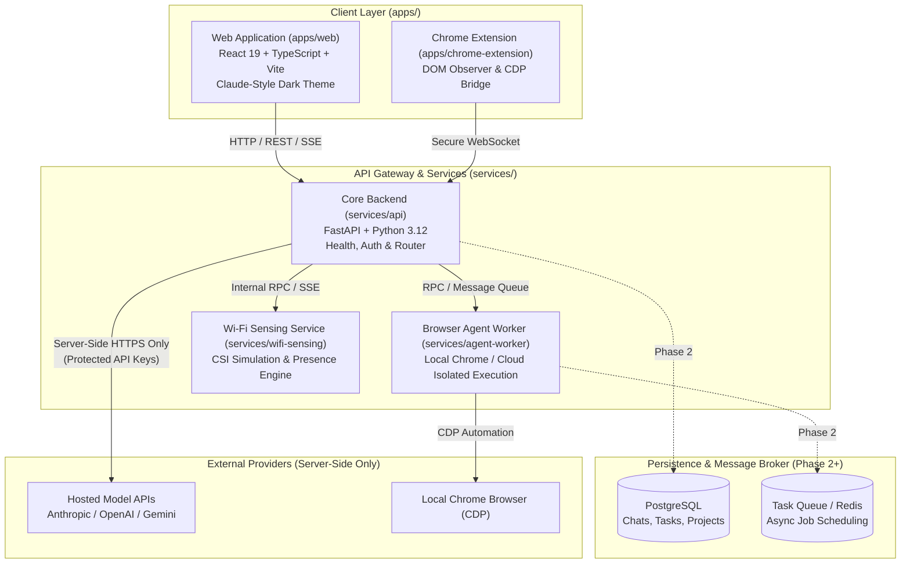

# Unified AI Assistant — System Architecture

## 1. Vision & Overview

The **Unified AI Assistant** is designed as a single cohesive AI workspace combining conversational intelligence, autonomous browser workflows, task/calendar orchestration, and environmental presence awareness (via Wi-Fi sensing).

The user experience centers around an uncluttered, distraction-free environment:
* **Claude-Inspired Dark Chat Interface**: Minimalist aesthetics, dark backgrounds, and large, elegant serif typography for model responses.
* **Unified Sidebar Navigation**:
  1. **New Chat** (instant conversation reset and model selector)
  2. **Search** (full-text conversation and knowledge base indexing)
  3. **Projects** (isolated workspaces with scoped instructions and documents)
  4. **Browser Agent** (autonomous web execution, visual preview, action controls)
  5. **Calendar & Tasks** (natural-language task creation, scheduling, reminders)
  6. **Files & Knowledge** (document uploads, citation graphs, vector retrieval in Phase 3+)
  7. **Wi-Fi Sensing** (environmental presence, occupancy metrics, non-intrusive activity telemetry)
  8. **Settings** (server-side provider management, preferences, execution policies)

---

## 2. High-Level Architecture Diagram



---

## 3. Monorepo Structure & Boundaries

```
unified-ai-assistant/
├── apps/
│   ├── web/                    # React 19 + Vite frontend
│   └── chrome-extension/       # Browser control extension
├── services/
│   ├── api/                    # Core FastAPI service
│   ├── agent-worker/           # Autonomous execution worker
│   └── wifi-sensing/           # Isolated Wi-Fi CSI sensing daemon
├── packages/
│   ├── shared-schemas/         # Common TypeScript & Pydantic models
│   └── ui/                     # Design tokens & UI components
├── docs/                       # Architecture, threat model, audits
├── tests/                      # Global end-to-end and health tests
├── .env.example                # Configuration template
├── .gitignore                  # Unified exclusion rules
├── README.md                   # Repository entrypoint
└── THIRD_PARTY_NOTICES.md      # Dependency license notices
```

---

## 4. Subsystem Specifications

### 4.1. Core API (`services/api`)
* **Role**: Primary orchestrator, authentication layer, and proxy to hosted LLM APIs.
* **Key Constraint**: Hosted model APIs only. All secret keys (`ANTHROPIC_API_KEY`, `OPENAI_API_KEY`, `GEMINI_API_KEY`) reside exclusively in server-side configuration. The frontend never accesses or proxies third-party provider keys directly.
* **Streaming**: Emits Server-Sent Events (SSE) or WebSocket streams to `apps/web` for incremental response delivery.

### 4.2. Autonomous Browser Agent (`services/agent-worker`)
* **Role**: Executes multi-step web browsing tasks.
* **Phased Execution**:
  * *Local Execution*: Connects to the user's running Chrome via Chrome DevTools Protocol (CDP) or via the dedicated extension in `apps/chrome-extension`.
  * *Isolated Cloud Execution (Later Phase)*: Spins up ephemeral containerized headless browsers for untrusted web navigation.
* **Safety & Guardrails**: Human-in-the-loop confirmation before sensitive actions (e.g., submitting forms with credentials, financial transactions, data downloads).

### 4.3. Wi-Fi Sensing Service (`services/wifi-sensing`)
* **Role**: Provides ambient environmental awareness through Wi-Fi Channel State Information (CSI) perturbation analysis.
* **Isolation**: Operates as a distinct service communicating through internal events.
* **Initial Simulation**: Uses simulated CSI streams generating synthetic subcarrier variance to model room entry, exit, sitting, and breathing patterns.

### 4.4. Calendar & Task Management
* **Role**: Translates conversational requests ("remind me to review PR tomorrow at 10 AM") into structured tasks, calendar entries, and alert triggers.
* **Persistence (Phase 2+)**: PostgreSQL with indexed timestamps and recurrence rules.

---

## 5. Technology Stack Decisions

| Component | Selected Technology | Rationale |
| :--- | :--- | :--- |
| **Frontend Framework** | React 19, TypeScript | High-performance component rendering, modern hook primitives |
| **Build Tool** | Vite 8 | Near-instant HMR, optimized production builds |
| **Backend Framework** | FastAPI 0.162, Pydantic 2.14 | High-throughput asynchronous endpoints, automatic OpenAPI documentation, strict schema validation |
| **Server Runtime** | Python 3.12 (Uvicorn 0.54) | Broad ecosystem compatibility for signal processing and backend services |
| **Persistence (Phase 2+)** | PostgreSQL | Robust relational integrity for chat histories, project scopes, and tasks |
| **Styling** | Modern CSS / Tailwind (Phase 1) | Custom design system adhering to serif typography and dark workspace specifications |

---

## 6. Phased Roadmap

* **Phase 0 (Current)**: Repository Foundation, Monorepo Topology, Environment Audit, Verified Health Endpoints.
* **Phase 1**: Claude-Inspired Dark UI with Sidebar Navigation, Large Serif AI Response Typography, Mock-free Chat Stream Contracts.
* **Phase 2**: Backend Persistence (PostgreSQL), Hosted Model Providers Integration (Server-Side), Chat History.
* **Phase 3**: Browser Agent Scaffolding & Local Chrome CDP Bridge.
* **Phase 4**: Natural-Language Task Management & Calendar Integration.
* **Phase 5**: Wi-Fi Sensing Simulation Service & Presence Events.
* **Phase 6**: Cloud Browser Isolation & Hardening.
