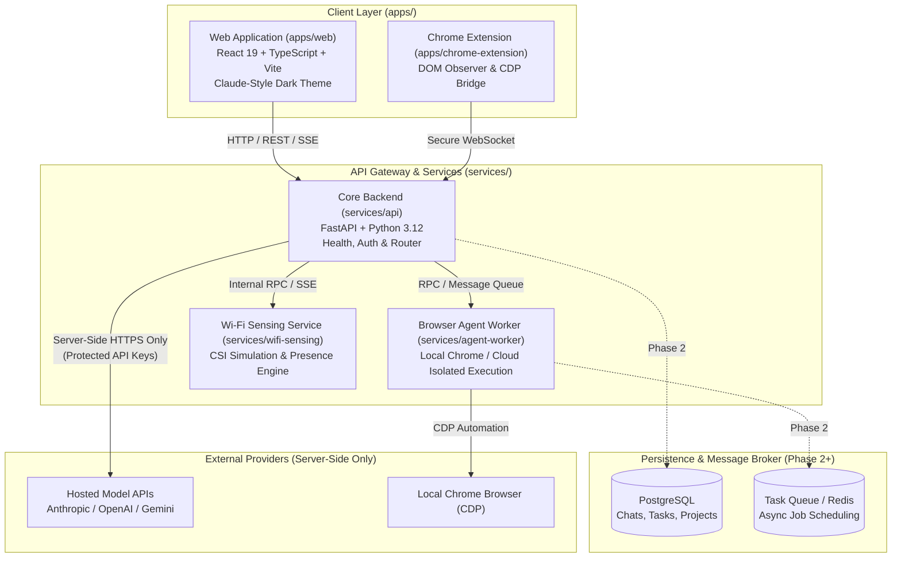

# Unified AI Assistant — System Architecture

## 1. Vision & Overview

The **Unified AI Assistant** is designed as a single cohesive AI workspace combining conversational intelligence, autonomous browser workflows, task/calendar orchestration, and environmental presence awareness (via Wi-Fi sensing).

The user experience centers around an uncluttered, distraction-free environment:
* **Claude-Inspired Dark Chat Interface**: Minimalist aesthetics, dark backgrounds, and large, elegant serif typography for model responses.
* **Unified Sidebar Navigation**:
  1. **New Chat** (instant conversation reset and model selector)
  2. **Search** (full-text conversation and knowledge base indexing)
  3. **Projects** (isolated workspaces with scoped instructions and documents)
  4. **Browser Agent** (autonomous web execution, visual preview, action controls)
  5. **Calendar & Tasks** (natural-language task creation, scheduling, reminders)
  6. **Files & Knowledge** (document uploads, citation graphs, vector retrieval in Phase 3+)
  7. **Wi-Fi Sensing** (environmental presence, occupancy metrics, non-intrusive activity telemetry)
  8. **Settings** (server-side provider management, preferences, execution policies)

---

## 2. High-Level Architecture Diagram



---

## 3. Monorepo Structure & Boundaries

```
unified-ai-assistant/
├── apps/
│   ├── web/                    # React 19 + Vite frontend
│   └── chrome-extension/       # Browser control extension
├── services/
│   ├── api/                    # Core FastAPI service
│   ├── agent-worker/           # Autonomous execution worker
│   └── wifi-sensing/           # Isolated Wi-Fi CSI sensing daemon
├── packages/
│   ├── shared-schemas/         # Common TypeScript & Pydantic models
│   └── ui/                     # Design tokens & UI components
├── docs/                       # Architecture, threat model, audits
├── tests/                      # Global end-to-end and health tests
├── .env.example                # Configuration template
├── .gitignore                  # Unified exclusion rules
├── README.md                   # Repository entrypoint
└── THIRD_PARTY_NOTICES.md      # Dependency license notices
```

---

## 4. Subsystem Specifications

### 4.1. Core API (`services/api`)
* **Role**: Primary orchestrator, authentication layer, and proxy to hosted LLM APIs.
* **Key Constraint**: Hosted model APIs only. All secret keys (`ANTHROPIC_API_KEY`, `OPENAI_API_KEY`, `GEMINI_API_KEY`) reside exclusively in server-side configuration. The frontend never accesses or proxies third-party provider keys directly.
* **Streaming**: Emits Server-Sent Events (SSE) or WebSocket streams to `apps/web` for incremental response delivery.

### 4.2. Autonomous Browser Agent (`services/agent-worker`)
* **Role**: Executes multi-step web browsing tasks.
* **Phased Execution**:
  * *Local Execution*: Connects to the user's running Chrome via Chrome DevTools Protocol (CDP) or via the dedicated extension in `apps/chrome-extension`.
  * *Isolated Cloud Execution (Later Phase)*: Spins up ephemeral containerized headless browsers for untrusted web navigation.
* **Safety & Guardrails**: Human-in-the-loop confirmation before sensitive actions (e.g., submitting forms with credentials, financial transactions, data downloads).

### 4.3. Wi-Fi Sensing Service (`services/wifi-sensing`)
* **Role**: Provides ambient environmental awareness through Wi-Fi Channel State Information (CSI) perturbation analysis.
* **Isolation**: Operates as a distinct service communicating through internal events.
* **Initial Simulation**: Uses simulated CSI streams generating synthetic subcarrier variance to model room entry, exit, sitting, and breathing patterns.

### 4.4. Calendar & Task Management
* **Role**: Translates conversational requests ("remind me to review PR tomorrow at 10 AM") into structured tasks, calendar entries, and alert triggers.
* **Persistence (Phase 2+)**: PostgreSQL with indexed timestamps and recurrence rules.

---

## 5. Streaming API Contract & Protocol (Phase 1)

The assistant uses Server-Sent Events (SSE) over standard HTTP streaming (`text/event-stream`) to stream AI responses incrementally to the client.

### 5.1. Endpoints

* **`POST /api/chat/stream`**: Initiates a streaming response for a user message.
  * **Request Header**: `Content-Type: application/json`, `Accept: text/event-stream`
  * **Request Body**:
    ```json
    {
      "conversation_id": "optional-uuid-string-or-null",
      "message": "User text input string"
    }
    ```
  * **Response Format**: `text/event-stream` with blocks separated by double newlines (`\n\n`).
* **`GET /api/provider/status`**: Returns the server-side configuration status of hosted AI model providers without exposing secrets.
  * **Response**:
    ```json
    {
      "configured": false,
      "provider": null,
      "message": "No AI provider configured"
    }
    ```

### 5.2. Event Protocol Types

Each event block adheres to standard SSE framing:
```
event: <event_type>
data: {"event": "<event_type>", "conversation_id": "<uuid>", "message_id": "<uuid>", "data": { ... }}
```

Supported event types:
1. `message_start`: Emitted when the request has been received and streaming begins.
   * `data`: `{"role": "assistant"}`
2. `text_delta`: Emitted incrementally for every new token or text chunk.
   * `data`: `{"text": "chunk string"}`
3. `message_complete`: Emitted when the assistant response stream finishes cleanly or after an error.
   * `data`: `{"finish_reason": "stop" | "error" | "cancelled"}`
4. `error`: Emitted when an operational or configuration failure occurs.
   * `data`: `{"code": "<ERROR_CODE>", "message": "<Human-readable explanation>"}`

### 5.3. Error Invariants & Current Limitations

* **No Fake AI Output**: If no model provider API key (`OPENAI_API_KEY`, `ANTHROPIC_API_KEY`, `GEMINI_API_KEY`) is configured on the server, the stream emits:
  1. `message_start`
  2. `error` (`code: "PROVIDER_NOT_CONFIGURED"`)
  3. `message_complete` (`finish_reason: "error"`)
* **Client Handling**: The client detects the `error` event, displays the honest message in an accessible error state, and stops the stream without attempting to invent or demonstrate dummy AI responses.
* **Storage**: In Phase 1, conversations are stored in browser `localStorage` under `unified-ai-conversations`. Multi-device synchronization and server persistence are deferred to Phase 2 (PostgreSQL).

---

## 6. Technology Stack Decisions

| Component | Selected Technology | Rationale |
| :--- | :--- | :--- |
| **Frontend Framework** | React 19, TypeScript | High-performance component rendering, modern hook primitives |
| **Build Tool** | Vite 8 | Near-instant HMR, optimized production builds |
| **Backend Framework** | FastAPI 0.162, Pydantic 2.14 | High-throughput asynchronous endpoints, automatic OpenAPI documentation, strict schema validation |
| **Server Runtime** | Python 3.12 (Uvicorn 0.54) | Broad ecosystem compatibility for signal processing and backend services |
| **Persistence (Phase 2+)** | PostgreSQL | Robust relational integrity for chat histories, project scopes, and tasks |
| **Styling** | Modern CSS Custom Properties | Custom design system adhering to Georgia serif typography and Claude-style dark palette |

---

## 7. Phased Roadmap

* **Phase 0 — Repository Foundation** *(Completed)*: Scaffolding, dependency manifests, lockfiles, license audits, and verified health endpoints.
* **Phase 1 — Production-Quality Chat Workspace** *(Completed)*: Claude-inspired dark UI, sidebar navigation, Georgia serif AI typography, verified health connectivity, typed SSE streaming contract, and responsive layout.
* **Phase 2 — Persistence & Model Gateway**: Database models (PostgreSQL), server-side hosted model provider integration (OpenAI, Anthropic, Gemini), chat persistence, and search.
* **Phase 3 — Autonomous Browser Agent**: Local Chrome CDP integration and safety guardrails.
* **Phase 4 — Task & Calendar Engine**: Natural-language scheduling and internal calendar.
* **Phase 5 — Wi-Fi Sensing Service**: Environmental CSI simulation and presence events.
* **Phase 6 — Hardening & Cloud Browser Execution**: Sandbox isolation and production deployment.
