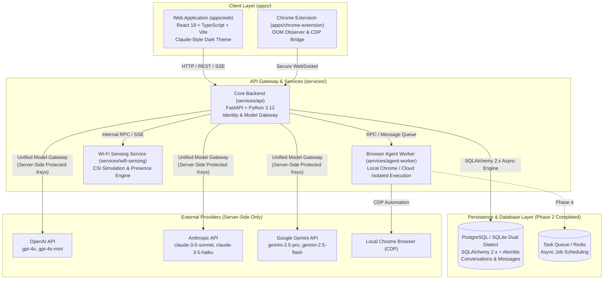

# Unified AI Assistant — System Architecture

## 1. Vision & Overview

The **Unified AI Assistant** is designed as a single cohesive AI workspace combining conversational intelligence, autonomous browser workflows, task/calendar orchestration, and environmental presence awareness (via Wi-Fi sensing).

The user experience centers around an uncluttered, distraction-free environment:
* **Claude-Inspired Dark Chat Interface**: Minimalist aesthetics, dark backgrounds (`#171717`, `#202020`, `#262626`), and large, elegant serif typography (Georgia 21px / line-height 1.6) for model responses.
* **Unified Sidebar Navigation**:
  1. **New Chat** (instant conversation reset and model selector)
  2. **Search** (database-backed full-text conversation and message search)
  3. **Projects** (isolated workspaces with scoped instructions and documents)
  4. **Browser Agent** (autonomous web execution, visual preview, action controls)
  5. **Calendar & Tasks** (natural-language task creation, scheduling, reminders)
  6. **Files & Knowledge** (document uploads, citation graphs, vector retrieval in Phase 3+)
  7. **Wi-Fi Sensing** (environmental presence, occupancy metrics, non-intrusive activity telemetry)
  8. **Settings** (server-side provider management, preferences, execution policies)

---

## 2. High-Level Architecture Diagram



---

## 3. Monorepo Structure & Boundaries

```
unified-ai-assistant/
├── apps/
│   ├── web/                    # React 19 + Vite frontend
│   └── chrome-extension/       # Browser control extension
├── services/
│   ├── api/                    # Core FastAPI backend service
│   │   ├── alembic/            # Alembic database migration scripts & versions
│   │   ├── models/             # SQLAlchemy 2.x ORM models (Conversation, Message)
│   │   ├── schemas/            # Pydantic v2 validation & response contracts
│   │   ├── providers/          # Hosted AI adapter implementations (OpenAI, Anthropic, Gemini)
│   │   ├── services/           # Business logic: ModelGateway, ConversationService, StreamingService
│   │   ├── routers/            # FastAPI route handlers (chat, conversations, providers)
│   │   ├── database.py         # Async engine & sessionmaker lifecycle
│   │   ├── config.py           # Environment settings & validation
│   │   └── main.py             # Application entrypoint & lifespan
│   ├── agent-worker/           # Autonomous execution worker
│   └── wifi-sensing/           # Isolated Wi-Fi CSI sensing daemon
├── packages/
│   ├── shared-schemas/         # Common TypeScript & Pydantic models
│   └── ui/                     # Design tokens & UI components
├── docs/                       # Architecture, threat model, audits
├── tests/                      # Pytest test suite (DB CRUD, Gateway, Streaming)
├── .env.example                # Configuration template
├── .gitignore                  # Unified exclusion rules
├── README.md                   # Repository entrypoint
└── THIRD_PARTY_NOTICES.md      # Dependency license notices
```

---

## 4. Subsystem Specifications

### 4.1. Core API (`services/api`)
* **Role**: Primary orchestrator, identity boundary, persistence engine, and gateway to hosted LLM APIs.
* **Key Constraint**: Hosted model APIs only. All secret keys (`ANTHROPIC_API_KEY`, `OPENAI_API_KEY`, `GEMINI_API_KEY`) reside exclusively in server-side configuration. The frontend never accesses or proxies third-party provider keys directly.
* **Streaming**: Emits Server-Sent Events (SSE) over HTTP (`text/event-stream`) with typed events (`message_start`, `text_delta`, `message_complete`, `error`).
* **Database**: SQLAlchemy 2.x async engine with dual-dialect support: production PostgreSQL (`postgresql+asyncpg://`) and local development fallback SQLite (`sqlite+aiosqlite:///`). Controlled strictly via Alembic migrations.

### 4.2. Development Identity Boundary
* **Design**: Dedicated request dependency in `services/api/routers/deps.py` extracting `Authorization: Bearer <token>` or falling back to `DEV_USER_ID` (`dev-user-default`).
* **Isolation**: All conversation queries (list, get, patch, delete, search) and message insertions filter strictly by `owner_id`. Cross-user access attempts return HTTP 404 (preventing user enumeration).
* **Migration to Production**: Pluggable architecture allowing seamless swap for JWT/OAuth2 session token validation in future authentication phases without changing database schemas or service layer logic.

### 4.3. Unified Model Gateway (`services/api/services/model_gateway.py`)
* **Abstraction**: Pluggable adapter architecture inheriting from `BaseProviderAdapter`.
* **Supported Adapters**:
  * `OpenAIProviderAdapter`: Implemented via `AsyncOpenAI` (`gpt-4o`, `gpt-4o-mini`).
  * `AnthropicProviderAdapter`: Implemented via `AsyncAnthropic` (`claude-3-5-sonnet-20241022`, `claude-3-5-haiku-20241022`).
  * `GeminiProviderAdapter`: Implemented via `google.genai.Client` (`gemini-2.5-pro`, `gemini-2.5-flash`).
* **Error Normalization**: Maps vendor exceptions into normalized `ProviderError` codes:
  * `AUTHENTICATION_FAILED`: Invalid API key or credentials.
  * `RATE_LIMIT_EXCEEDED`: Upstream quota or concurrency limit reached.
  * `TIMEOUT`: Upstream connection or read timeout.
  * `PROVIDER_UNAVAILABLE`: Upstream service down.
  * `INVALID_REQUEST`: Malformed model request.
* **Streaming Persistence**: Saves the user message prior to stream emission, updates the assistant record status to `streaming`, writes incremental chunks or finalized content, and marks status as `completed`, `interrupted`, or `error`.

### 4.4. Autonomous Browser Agent (`services/agent-worker`)
* **Role**: Executes multi-step, plan-governed browser automation workflows using Microsoft Playwright in isolated ephemeral sessions.
* **Separation of Concerns**: Long-running browser automation executes in background worker tasks without blocking the main FastAPI HTTP request loop.
* **Lifecycle & State Machine**:
  * `pending` / `awaiting_approval`: User defines a goal. A structured plan with typed actions is generated and displayed. Execution requires explicit operator approval (`POST /api/browser/tasks/{id}/approve`).
  * `running`: Worker launches a dedicated ephemeral Chromium instance (no cookies, passwords, or persistent local storage from everyday profiles).
  * `awaiting_confirmation`: When an action targets consequential operations (payments, account deletions, message transmissions), execution pauses and prompts for explicit operator confirmation (`POST /api/browser/tasks/{id}/confirm`).
  * `completed`: Execution terminates only after a final state verification step confirms observed DOM/URL state against the task goal.
  * `failed` / `cancelled`: Failures produce sanitized, path-redacted error messages; cancellation cleanly closes browser sessions immediately.
* **Security & Action Allowlist**:
  * Permitted action types: `navigate`, `inspect`, `read_text`, `click`, `type_text`, `scroll`, `wait_for`, `screenshot`.
  * Arbitrary shell, raw javascript execution, extension loading, and filesystem navigation (`file:///`) are prohibited.
  * SSRF Protection: Blocks private RFC 1918 subnets, loopback, and cloud metadata (`169.254.169.254`) on both initial navigation and post-navigation redirects.
  * Prompt-Injection Defense: Extracted DOM text is treated as untrusted data and strictly isolated from system execution directives.
* **Progress Streaming & Event Replay**: Live task events stream via SSE (`GET /api/browser/tasks/{id}/stream`) and persist to the `browser_task_events` table for full timeline replay upon reconnect.

### 4.5. Wi-Fi Sensing Service (`services/wifi-sensing`)
* **Role**: Provides ambient environmental awareness through Wi-Fi Channel State Information (CSI) perturbation analysis.
* **Isolation**: Operates as a distinct service communicating through internal events.
* **Initial Simulation**: Uses simulated CSI streams generating synthetic subcarrier variance to model room entry, exit, sitting, and breathing patterns.

---

## 5. Streaming API Contract & Protocol

The assistant uses Server-Sent Events (SSE) over standard HTTP streaming (`text/event-stream`) to stream AI responses incrementally to the client.

### 5.1. Endpoints

* **`POST /api/chat/stream`**: Initiates a streaming response for a user message.
  * **Request Header**: `Content-Type: application/json`, `Accept: text/event-stream`, `Authorization: Bearer <token>` (optional in dev)
  * **Request Body**:
    ```json
    {
      "conversation_id": "optional-uuid-string-or-null",
      "message": "User text input string",
      "provider": "optional-provider-id-or-null",
      "model": "optional-model-id-or-null"
    }
    ```
  * **Response Format**: `text/event-stream` with blocks separated by double newlines (`\n\n`).
* **`GET /api/provider/status`**: Returns the server-side configuration status and available models without exposing secrets.
  * **Response**:
    ```json
    {
      "configured": false,
      "provider": null,
      "active_provider": null,
      "active_model": null,
      "available_models": [],
      "providers": {
        "openai": false,
        "anthropic": false,
        "gemini": false
      },
      "message": "No AI provider configured. Add an API key to the server environment."
    }
    ```
* **`GET /api/conversations`**: Paginated conversation history for the authenticated user.
* **`POST /api/conversations`**: Explicitly create a new conversation.
* **`GET /api/conversations/{id}`**: Retrieve full conversation details and persisted message history.
* **`PATCH /api/conversations/{id}`**: Update conversation title.
* **`DELETE /api/conversations/{id}`**: Delete conversation and all cascaded messages.
* **`GET /api/conversations/search?q={query}`**: Database text search across conversation titles and message content.

### 5.2. Event Protocol Types

Each event block adheres to standard SSE framing:
```
event: <event_type>
data: {"event": "<event_type>", "conversation_id": "<uuid>", "message_id": "<uuid>", "data": { ... }}
```

Supported event types:
1. `message_start`: Emitted when the request has been received and streaming begins.
   * `data`: `{"role": "assistant"}`
2. `text_delta`: Emitted incrementally for every new token or text chunk.
   * `data`: `{"text": "chunk string"}`
3. `message_complete`: Emitted when the assistant response stream finishes cleanly or after an error.
   * `data`: `{"finish_reason": "stop" | "error" | "cancelled", "provider": "openai", "model": "gpt-4o"}`
4. `error`: Emitted when an operational or configuration failure occurs.
   * `data`: `{"code": "<ERROR_CODE>", "message": "<Human-readable explanation>"}`

### 5.3. Error Invariants

* **No Fake AI Output**: If no model provider API key (`OPENAI_API_KEY`, `ANTHROPIC_API_KEY`, `GEMINI_API_KEY`) is configured on the server, the stream emits:
  1. `message_start`
  2. `error` (`code: "PROVIDER_NOT_CONFIGURED"`)
  3. `message_complete` (`finish_reason: "error"`)
* **Persistence Guarantee**: User prompts and streaming assistant messages are recorded in the database. If a stream is aborted, disconnected, or encounters an upstream provider error, the message record is persisted with status `interrupted` or `error`.

---

## 6. Technology Stack Decisions

| Component | Selected Technology | Rationale |
| :--- | :--- | :--- |
| **Frontend Framework** | React 19, TypeScript | High-performance component rendering, modern hook primitives |
| **Build Tool** | Vite 8 | Near-instant HMR, optimized production builds |
| **Backend Framework** | FastAPI 0.162, Pydantic 2.14 | High-throughput asynchronous endpoints, automatic OpenAPI documentation, strict schema validation |
| **Server Runtime** | Python 3.12 (Uvicorn 0.54) | Broad ecosystem compatibility for signal processing and backend services |
| **Database & ORM** | SQLAlchemy 2.x + Alembic | Async relational persistence with declarative schema migration version control |
| **Database Drivers** | asyncpg, aiosqlite, psycopg2-binary | Native async drivers for PostgreSQL production and SQLite dev fallback |
| **AI SDKs** | openai, anthropic, google-genai | Official client libraries running strictly server-side |
| **Styling** | Modern CSS Custom Properties | Custom design system adhering to Georgia serif typography and Claude-style dark palette |

---

## 7. Phased Roadmap

* **Phase 0 — Repository Foundation** *(Completed)*: Scaffolding, dependency manifests, lockfiles, license audits, and verified health endpoints.
* **Phase 1 — Production-Quality Chat Workspace** *(Completed)*: Claude-inspired dark UI, sidebar navigation, Georgia serif AI typography, verified health connectivity, typed SSE streaming contract, and responsive layout.
* **Phase 2 — Persistence & Model Gateway** *(Completed)*: Dual-dialect database persistence (PostgreSQL/SQLite), Alembic migrations, ownership boundaries, Unified Model Gateway with OpenAI/Anthropic/Gemini adapters, conversation CRUD, database text search, and client UI integration.
* **Phase 3 — Autonomous Browser Agent** *(Completed)*: Playwright-powered local browser execution engine in dedicated background worker, isolated ephemeral contexts, database task persistence and Alembic migrations, action allowlist, SSRF/private IP blocking, post-navigation redirect revalidation, untrusted DOM prompt injection defense, consequential action confirmation gates, real-time SSE progress streaming, and interactive frontend Browser Agent workspace.
* **Phase 4 — Task & Calendar Engine**: Natural-language scheduling and internal calendar.
* **Phase 5 — Wi-Fi Sensing Service**: Environmental CSI simulation and presence events.
* **Phase 6 — Hardening & Cloud Browser Execution**: Sandbox isolation and production deployment.
