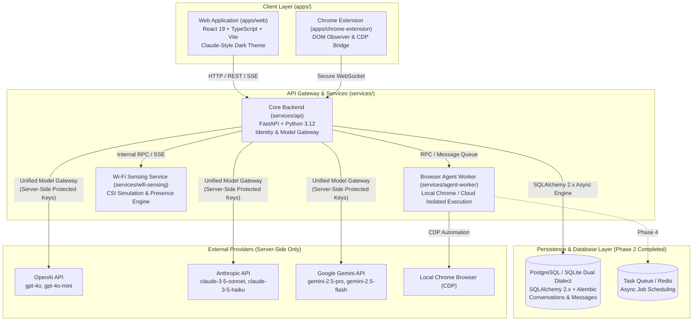
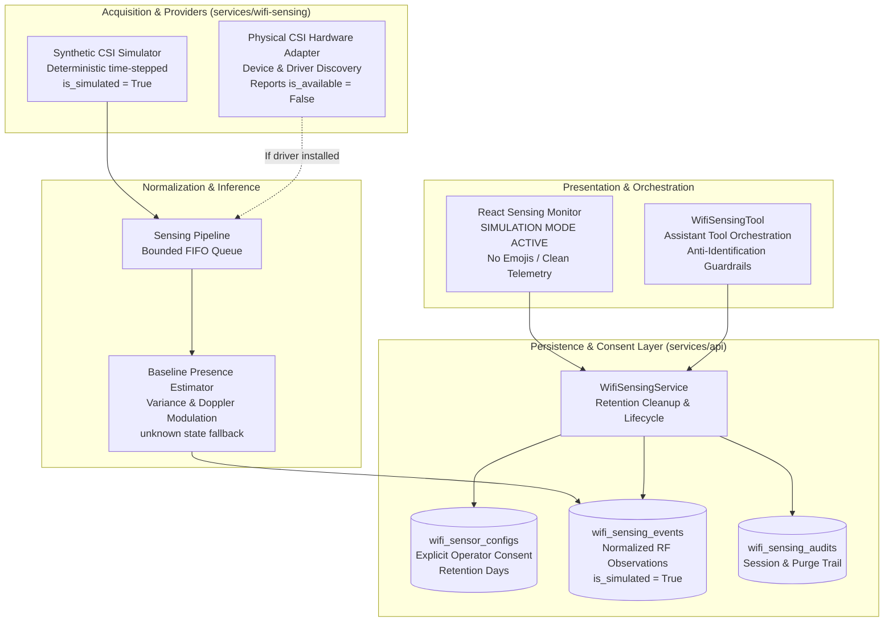

# Unified AI Assistant — System Architecture

## 1. Vision & Overview

The **Unified AI Assistant** is designed as a single cohesive AI workspace combining conversational intelligence, autonomous browser workflows, task/calendar orchestration, and environmental presence awareness (via Wi-Fi sensing).

The user experience centers around an uncluttered, distraction-free environment:
* **Claude-Inspired Dark Chat Interface**: Minimalist aesthetics, dark backgrounds (`#171717`, `#202020`, `#262626`), and large, elegant serif typography (Georgia 21px / line-height 1.6) for model responses.
* **Unified Sidebar Navigation**:
  1. **New Chat** (instant conversation reset and model selector)
  2. **Search** (database-backed full-text conversation and message search)
  3. **Projects** (isolated workspaces with scoped instructions and documents)
  4. **Browser Agent** (autonomous web execution, visual preview, action controls)
  5. **Calendar & Tasks** (natural-language task creation, scheduling, reminders)
  6. **Files & Knowledge** (document uploads, citation graphs, vector retrieval in Phase 3+)
  7. **Wi-Fi Sensing** (environmental presence, occupancy metrics, non-intrusive activity telemetry)
  8. **Settings** (server-side provider management, preferences, execution policies)

---

## 2. High-Level Architecture Diagram



---

## 3. Monorepo Structure & Boundaries

```
unified-ai-assistant/
├── apps/
│   ├── web/                    # React 19 + Vite frontend
│   └── chrome-extension/       # Browser control extension
├── services/
│   ├── api/                    # Core FastAPI backend service
│   │   ├── alembic/            # Alembic database migration scripts & versions
│   │   ├── models/             # SQLAlchemy 2.x ORM models (Conversation, Message)
│   │   ├── schemas/            # Pydantic v2 validation & response contracts
│   │   ├── providers/          # Hosted AI adapter implementations (OpenAI, Anthropic, Gemini)
│   │   ├── services/           # Business logic: ModelGateway, ConversationService, StreamingService
│   │   ├── routers/            # FastAPI route handlers (chat, conversations, providers)
│   │   ├── database.py         # Async engine & sessionmaker lifecycle
│   │   ├── config.py           # Environment settings & validation
│   │   └── main.py             # Application entrypoint & lifespan
│   ├── agent-worker/           # Autonomous execution worker
│   └── wifi-sensing/           # Isolated Wi-Fi CSI sensing daemon
├── packages/
│   ├── shared-schemas/         # Common TypeScript & Pydantic models
│   └── ui/                     # Design tokens & UI components
├── docs/                       # Architecture, threat model, audits
├── tests/                      # Pytest test suite (DB CRUD, Gateway, Streaming)
├── .env.example                # Configuration template
├── .gitignore                  # Unified exclusion rules
├── README.md                   # Repository entrypoint
└── THIRD_PARTY_NOTICES.md      # Dependency license notices
```

---

## 4. Subsystem Specifications

### 4.1. Core API (`services/api`)
* **Role**: Primary orchestrator, identity boundary, persistence engine, and gateway to hosted LLM APIs.
* **Key Constraint**: Hosted model APIs only. All secret keys (`ANTHROPIC_API_KEY`, `OPENAI_API_KEY`, `GEMINI_API_KEY`) reside exclusively in server-side configuration. The frontend never accesses or proxies third-party provider keys directly.
* **Streaming**: Emits Server-Sent Events (SSE) over HTTP (`text/event-stream`) with typed events (`message_start`, `text_delta`, `message_complete`, `error`).
* **Database**: SQLAlchemy 2.x async engine with dual-dialect support: production PostgreSQL (`postgresql+asyncpg://`) and local development fallback SQLite (`sqlite+aiosqlite:///`). Controlled strictly via Alembic migrations.

### 4.2. Development Identity Boundary
* **Design**: Dedicated request dependency in `services/api/routers/deps.py` extracting `Authorization: Bearer <token>` or falling back to `DEV_USER_ID` (`dev-user-default`).
* **Isolation**: All conversation queries (list, get, patch, delete, search) and message insertions filter strictly by `owner_id`. Cross-user access attempts return HTTP 404 (preventing user enumeration).
* **Migration to Production**: Pluggable architecture allowing seamless swap for JWT/OAuth2 session token validation in future authentication phases without changing database schemas or service layer logic.

### 4.3. Unified Model Gateway (`services/api/services/model_gateway.py`)
* **Abstraction**: Pluggable adapter architecture inheriting from `BaseProviderAdapter`.
* **Supported Adapters**:
  * `OpenAIProviderAdapter`: Implemented via `AsyncOpenAI` (`gpt-4o`, `gpt-4o-mini`).
  * `AnthropicProviderAdapter`: Implemented via `AsyncAnthropic` (`claude-3-5-sonnet-20241022`, `claude-3-5-haiku-20241022`).
  * `GeminiProviderAdapter`: Implemented via `google.genai.Client` (`gemini-2.5-pro`, `gemini-2.5-flash`).
* **Error Normalization**: Maps vendor exceptions into normalized `ProviderError` codes:
  * `AUTHENTICATION_FAILED`: Invalid API key or credentials.
  * `RATE_LIMIT_EXCEEDED`: Upstream quota or concurrency limit reached.
  * `TIMEOUT`: Upstream connection or read timeout.
  * `PROVIDER_UNAVAILABLE`: Upstream service down.
  * `INVALID_REQUEST`: Malformed model request.
* **Streaming Persistence**: Saves the user message prior to stream emission, updates the assistant record status to `streaming`, writes incremental chunks or finalized content, and marks status as `completed`, `interrupted`, or `error`.

### 4.4. Autonomous Browser Agent (`services/agent-worker`)
* **Role**: Executes multi-step, plan-governed browser automation workflows using Microsoft Playwright in isolated ephemeral sessions.
* **Separation of Concerns**: Long-running browser automation executes in background worker tasks without blocking the main FastAPI HTTP request loop.
* **Lifecycle & State Machine**:
  * `pending` / `awaiting_approval`: User defines a goal. A structured plan with typed actions is generated and displayed. Execution requires explicit operator approval (`POST /api/browser/tasks/{id}/approve`).
  * `running`: Worker launches a dedicated ephemeral Chromium instance (no cookies, passwords, or persistent local storage from everyday profiles).
  * `awaiting_confirmation`: When an action targets consequential operations (payments, account deletions, message transmissions), execution pauses and prompts for explicit operator confirmation (`POST /api/browser/tasks/{id}/confirm`).
  * `completed`: Execution terminates only after a final state verification step confirms observed DOM/URL state against the task goal.
  * `failed` / `cancelled`: Failures produce sanitized, path-redacted error messages; cancellation cleanly closes browser sessions immediately.
* **Security & Action Allowlist**:
  * Permitted action types: `navigate`, `inspect`, `read_text`, `click`, `type_text`, `scroll`, `wait_for`, `screenshot`.
  * Arbitrary shell, raw javascript execution, extension loading, and filesystem navigation (`file:///`) are prohibited.
  * SSRF Protection: Blocks private RFC 1918 subnets, loopback, and cloud metadata (`169.254.169.254`) on both initial navigation and post-navigation redirects.
  * Prompt-Injection Defense: Extracted DOM text is treated as untrusted data and strictly isolated from system execution directives.
* **Progress Streaming & Event Replay**: Live task events stream via SSE (`GET /api/browser/tasks/{id}/stream`) and persist to the `browser_task_events` table for full timeline replay upon reconnect.

### 4.5. Task & Calendar Engine (`services/api/services/task_service.py`, `calendar_service.py`, `reminder_service.py`, `reminder_scheduler.py`)
* **Role**: Provides internal, self-hosted task management, calendar event scheduling, and reliable reminder notifications with AI extraction.
* **Key Constraints**: Internal only. No third-party sync (e.g. Google Calendar), SMS, or email services in Phase 4.
* **Data Models & Persistence**:
  * `Task`: Tracks `id`, `owner_id`, `title`, `description`, `priority` (`low`, `medium`, `high`, `urgent`), `status` (`pending`, `in_progress`, `completed`, `cancelled`), `due_date`, `start_date`, `timezone`, `completed_at`, and foreign keys to conversations/messages. Includes idempotent completion toggling.
  * `CalendarEvent`: Tracks `id`, `owner_id`, `title`, `description`, `start_time`, `end_time`, `timezone` (IANA validated), `all_day`, `location`, `recurrence_rule`, and `color`.
  * `Reminder`: Tracks `id`, `owner_id`, `title`, `task_id`, `event_id`, `scheduled_time`, `status` (`scheduled`, `processing`, `delivered`, `dismissed`, `failed`), `delivery_attempts`, and optional client `idempotency_key`.
* **Bounded Recurrence**:
  * Evaluates a clean, bounded subset of iCalendar RRULE (`FREQ=DAILY|WEEKLY|MONTHLY`, `INTERVAL`, `COUNT`, `UNTIL`, `BYDAY`).
  * Enforces security bounds: maximum 50 occurrences per expansion and a 366-day (1-year) horizon to prevent Denial-of-Service loops.
* **Background Reminder Scheduler**:
  * Runs as an asynchronous polling worker inside the FastAPI lifespan (`scheduler_instance.start()` / `stop()`).
  * Performs atomic status claiming (`UPDATE reminders SET status = 'processing', delivery_attempts = delivery_attempts + 1 WHERE id = :id AND status = 'scheduled'`) to prevent race conditions.
  * Recovers past-due and restart-interrupted reminders seamlessly on startup.
  * Bounded retry logic (max 3 delivery attempts) recording errors and marking terminal failures.
* **Natural Language Extraction**:
  * Uses the unified `ModelGateway` to parse unstructured user input into structured task, event, and reminder proposals.
  * Resolves relative date references ("tomorrow at 2pm", "Friday 5pm") using server-provided reference timestamp and the user's local timezone.
  * **Mandatory Confirmation**: Extraction returns structured proposals with `requires_confirmation: true`. Records are never written directly to the database without explicit human approval.

### 4.6. Wi-Fi Sensing Service (`services/wifi-sensing`)
* **Role**: Provides ambient environmental presence awareness and activity estimation based on Channel State Information (CSI) disturbance dynamics.
* **Isolation**: Operates as a distinct modular domain boundary with strict separation across acquisition, normalization, inference, persistence, and presentation.
* **Simulation Mode**: Uses deterministic mathematical modeling of subcarrier amplitude variance and Doppler proxies to model room entry, exit, sitting, and breathing patterns. Unmistakably labels all telemetry as synthetic.
* **Hardware Boundary**: Features an honest physical CSI adapter that verifies hardware presence and driver availability, declaring real hardware unavailable when compatible capture NICs are absent.

---

## 5. Streaming API Contract & Protocol

The assistant uses Server-Sent Events (SSE) over standard HTTP streaming (`text/event-stream`) to stream AI responses incrementally to the client.

### 5.1. Endpoints

* **`POST /api/chat/stream`**: Initiates a streaming response for a user message.
  * **Request Header**: `Content-Type: application/json`, `Accept: text/event-stream`, `Authorization: Bearer <token>` (optional in dev)
  * **Request Body**:
    ```json
    {
      "conversation_id": "optional-uuid-string-or-null",
      "message": "User text input string",
      "provider": "optional-provider-id-or-null",
      "model": "optional-model-id-or-null"
    }
    ```
  * **Response Format**: `text/event-stream` with blocks separated by double newlines (`\n\n`).
* **`GET /api/provider/status`**: Returns the server-side configuration status and available models without exposing secrets.
  * **Response**:
    ```json
    {
      "configured": false,
      "provider": null,
      "active_provider": null,
      "active_model": null,
      "available_models": [],
      "providers": {
        "openai": false,
        "anthropic": false,
        "gemini": false
      },
      "message": "No AI provider configured. Add an API key to the server environment."
    }
    ```
* **`GET /api/conversations`**: Paginated conversation history for the authenticated user.
* **`POST /api/conversations`**: Explicitly create a new conversation.
* **`GET /api/conversations/{id}`**: Retrieve full conversation details and persisted message history.
* **`PATCH /api/conversations/{id}`**: Update conversation title.
* **`DELETE /api/conversations/{id}`**: Delete conversation and all cascaded messages.
* **`GET /api/conversations/search?q={query}`**: Database text search across conversation titles and message content.

### 5.2. Event Protocol Types

Each event block adheres to standard SSE framing:
```
event: <event_type>
data: {"event": "<event_type>", "conversation_id": "<uuid>", "message_id": "<uuid>", "data": { ... }}
```

Supported event types:
1. `message_start`: Emitted when the request has been received and streaming begins.
   * `data`: `{"role": "assistant"}`
2. `text_delta`: Emitted incrementally for every new token or text chunk.
   * `data`: `{"text": "chunk string"}`
3. `message_complete`: Emitted when the assistant response stream finishes cleanly or after an error.
   * `data`: `{"finish_reason": "stop" | "error" | "cancelled", "provider": "openai", "model": "gpt-4o"}`
4. `error`: Emitted when an operational or configuration failure occurs.
   * `data`: `{"code": "<ERROR_CODE>", "message": "<Human-readable explanation>"}`

### 5.3. Error Invariants

* **No Fake AI Output**: If no model provider API key (`OPENAI_API_KEY`, `ANTHROPIC_API_KEY`, `GEMINI_API_KEY`) is configured on the server, the stream emits:
  1. `message_start`
  2. `error` (`code: "PROVIDER_NOT_CONFIGURED"`)
  3. `message_complete` (`finish_reason: "error"`)
* **Persistence Guarantee**: User prompts and streaming assistant messages are recorded in the database. If a stream is aborted, disconnected, or encounters an upstream provider error, the message record is persisted with status `interrupted` or `error`.

---

## 6. Technology Stack Decisions

| Component | Selected Technology | Rationale |
| :--- | :--- | :--- |
| **Frontend Framework** | React 19, TypeScript | High-performance component rendering, modern hook primitives |
| **Build Tool** | Vite 8 | Near-instant HMR, optimized production builds |
| **Backend Framework** | FastAPI 0.162, Pydantic 2.14 | High-throughput asynchronous endpoints, automatic OpenAPI documentation, strict schema validation |
| **Server Runtime** | Python 3.12 (Uvicorn 0.54) | Broad ecosystem compatibility for signal processing and backend services |
| **Database & ORM** | SQLAlchemy 2.x + Alembic | Async relational persistence with declarative schema migration version control |
| **Database Drivers** | asyncpg, aiosqlite, psycopg2-binary | Native async drivers for PostgreSQL production and SQLite dev fallback |
| **AI SDKs** | openai, anthropic, google-genai | Official client libraries running strictly server-side |
| **Styling** | Modern CSS Custom Properties | Custom design system adhering to Georgia serif typography and Claude-style dark palette |

---

## 7. Phased Roadmap

* **Phase 0 — Repository Foundation** *(Completed)*: Scaffolding, dependency manifests, lockfiles, license audits, and verified health endpoints.
* **Phase 1 — Production-Quality Chat Workspace** *(Completed)*: Claude-inspired dark UI, sidebar navigation, Georgia serif AI typography, verified health connectivity, typed SSE streaming contract, and responsive layout.
* **Phase 2 — Persistence & Model Gateway** *(Completed)*: Dual-dialect database persistence (PostgreSQL/SQLite), Alembic migrations, ownership boundaries, Unified Model Gateway with OpenAI/Anthropic/Gemini adapters, conversation CRUD, database text search, and client UI integration.
* **Phase 3 — Autonomous Browser Agent** *(Completed)*: Playwright-powered local browser execution engine in dedicated background worker, isolated ephemeral contexts, database task persistence and Alembic migrations, action allowlist, SSRF/private IP blocking, post-navigation redirect revalidation, untrusted DOM prompt injection defense, consequential action confirmation gates, real-time SSE progress streaming, and interactive frontend Browser Agent workspace.
* **Phase 4 — Task & Calendar Engine** *(Completed)*: Internal task tracking with idempotent completion toggling, calendar events with bounded RRULE recurrence expansion, atomic background reminder scheduler surviving restarts, natural language task/event extraction with mandatory operator confirmation, strict ownership isolation, and Claude-inspired dark Calendar & Tasks workspace.
* **Phase 5 — Files & Knowledge Engine** *(Completed)*: Secure private document storage outside public web roots, modular text extractors (PDF via pypdf, DOCX via python-docx, TXT, MD, CSV, Code/JSON), magic byte validation, content SHA-256 deduplication, bounded chunking with page/section provenance, pluggable embedding providers with dual-strategy retrieval (semantic vector search with cosine similarity + honest lexical fallback), grounded Q&A with strict prompt injection isolation, verified citation badges `[Doc: filename, Page X]`, streaming RAG chat integration, and full Claude-inspired frontend files workspace.
* **Phase 6 — Web Research & Browser Intelligence** *(Completed)*: Autonomous, source-grounded research investigations with provider-neutral search discovery, isolated Playwright evidence extraction, SSRF/private IP blocking with post-navigation redirect revalidation, DOM prompt injection defense, grounded synthesis with traceable citations (`[Web N: Title]` and Phase 5 document correlation `[Doc: filename, Page X]`), honest insufficient evidence reporting, Markdown report exports, and SSE chat streaming integration.
* **Phase 7 — Wi-Fi Sensing Service**: Environmental CSI simulation and presence events.
* **Phase 8 — Hardening & Cloud Browser Execution**: Sandbox isolation and production deployment.

---

## 8. Web Research & Browser Intelligence Architecture (Phase 6)

The Web Research subsystem enables autonomous, source-grounded investigations that discover web sources, crawl relevant pages safely using isolated browser infrastructure, extract verified evidence, correlate findings against the user's uploaded documents (Phase 5 Knowledge Engine), and synthesize structured reports with traceable citations.

### 8.1 Subsystem Design

```
+----------------------------------------------------------------------------------+
|                            Web Research Subsystem                                |
+----------------------------------------------------------------------------------+
  1. POST /api/research/jobs
     ├── ResearchJobService.create_job()
     ├── Dynamic Plan Generation (search, browse, compare_documents, synthesize)
     └── State: 'awaiting_approval' (if deep / requested) or 'running'
  
  2. Plan Approval & Cancellation
     ├── POST /api/research/jobs/{id}/approve -> 'running' (starts background pipeline)
     └── POST /api/research/jobs/{id}/cancel -> 'cancelled' with audited reason
  
  3. Search & Source Discovery
     ├── BaseSearchProvider interface (DuckDuckGo, Mock, extensible)
     ├── URL Canonicalization & Deduplication (strips utm_*, fbclid, fragments, slashes)
     └── Persists ResearchSource records with status 'pending'
  
  4. Evidence Collection (WebCollector)
     ├── Pre-navigation SSRF Policy Check (validate_url blocks loopback, private IPs, metadata)
     ├── Ephemeral Playwright Browser Session (BrowserSessionManager)
     ├── Post-Navigation Redirect Re-validation (blocks redirect targets violating SSRF policy)
     ├── Content-Type Check (rejects non-HTML binary payloads)
     ├── Publication Date & SHA-256 Content Hash Extraction
     └── DOM Prompt-Injection Defense (sanitize_page_text, detect_prompt_injection)
  
  5. Document Correlation (Phase 5 Knowledge Integration)
     └── KnowledgeService.search() scoped strictly to authenticated owner's files
  
  6. Grounded Synthesis (ResearchSynthesizer)
     ├── Multi-Provider ModelGateway invocation with strict untrusted data prompt guardrails
     ├── Structured Schema: Executive Summary, Key Findings, Evidence, Conflicts, Limitations
     ├── Traceable Citations: [Web N: Title] and [Doc: filename, Page X]
     └── Honest Fallback: Highlights insufficient evidence when sources are scarce
  
  7. Delivery & Export
     ├── GET /api/research/jobs/{id}/report (JSON) & /api/research/jobs/{id}/export (Markdown)
     └── POST /api/chat/stream with use_research=True emitting progress & citations
```

### 8.2 State Machine & Recovery

Jobs transition through explicit, audited states:
`planning` -> `awaiting_approval` -> `running` -> `synthesizing` -> `completed` (or `cancelled` / `failed`).
On application startup, `ResearchJobService.recover_dangling_jobs()` reconciles any jobs left in `planning`, `running`, or `synthesizing` state from an unexpected server termination, safely transitioning them to `failed` with clear recovery guidance.

---

## 8. Files & Knowledge Engine Architecture (Phase 5)

### 8.1. Document Lifecycle & Storage Isolation
All uploaded files are saved into private directory trees segmented by owner ID hash (`data/storage/{owner_hash}/{file_id}.ext`), entirely isolated from static public file serving routes.
- **Quota Enforcements**: Maximum 20 MB per file, 100 MB aggregate storage quota per user, 50 file limit per user.
- **Security Boundaries**: Filename sanitization blocks path-traversal attempts (`../`, `..\`). File headers undergo magic byte signature verification (preventing disguised `.exe` / `.bin` binaries from executing).
- **Deduplication**: Content SHA-256 hashes are calculated upon upload; identical byte streams reuse storage files without redundant disk usage.

### 8.2. Extraction & Provenance Tracking
- **`PdfExtractor`**: Uses `pypdf` to extract text page-by-page, recording 1-based `page_number` provenance for every paragraph.
- **`DocxExtractor`**: Uses `python-docx` to extract structured headings and paragraphs, preserving section hierarchy.
- **`CsvExtractor`**: Parses rows into tabular text representations preserving column headers.
- **`TextExtractor`**: Handles plain text, markdown, source code (`.py`, `.ts`, `.json`, `.sql`) with UTF-8 / Latin-1 encoding fallbacks.
- **Bounded Extraction**: Extracted text is capped at 2,000,000 characters to prevent resource exhaustion.

### 8.3. Dual Retrieval & Grounded Q&A
- **Pluggable Embeddings**: Implements `BaseEmbeddingProvider` supporting OpenAI (`text-embedding-3-small`), Gemini (`text-embedding-004`), and `MockEmbeddingProvider`. Embeddings are stored as JSON float arrays in the database to support both PostgreSQL and local SQLite.
- **Retrieval Strategy**: When embeddings are configured, cosine similarity ranks relevant chunks. When no embedding API key is present, an honest lexical keyword matching strategy is used.
- **Grounded Synthesis**: Grounded answers quote verified excerpts in `[Doc: filename, Page X]` format. Extracted document text is strictly isolated in the prompt as untrusted reference material, preventing prompt injection attacks from overriding system instructions. If document evidence is insufficient, the system honestly reports insufficient context.

---

## 9. Wi-Fi Sensing Subsystem Architecture (Phase 7)



### 9.1. Acquisition & Hardware Boundary
- **Synthetic Simulation**: Employs deterministic mathematical modeling of RF perturbation regimes:
  - *Vacant*: Ambient thermal floor (variance ~0.015, Doppler ~0.008, RSSI -64 dBm).
  - *Stationary*: Periodic sinusoidal breathing modulation (~0.25 Hz, variance ~0.15, Doppler ~0.12).
  - *Motion*: Active multi-path Doppler shifts (variance ~0.50-0.85, Doppler ~0.70, RSSI -52 dBm).
- **Physical CSI Boundary**: Standard consumer Wi-Fi cards and OS stacks do not expose 802.11 CSI without specialized firmware (e.g. Intel 5300, Atheros 9k, ESP32-CSI). The `HardwareSensorAdapter` honestly tests for genuine CSI drivers and reports `is_available: False` when unsupported, never fabricating hardware detection or simulating under a hardware label.

### 9.2. Presence Estimation & The Unknown State
- The `BaselinePresenceEstimator` evaluates normalized RF perturbation scores against bounded baselines.
- **Handling Invalid/Degraded Data**: If signal quality drops below 40%, packet counts are zero, or RSSI falls outside [-120 dBm, -10 dBm], the estimator immediately emits an explicit `presence_state = "unknown"` with `presence_probability = None` and `quality_score = 0.0`. Missing data is never treated as proof of absence.
- **Zero Identification**: The estimator operates on anonymous RF energy and subcarrier variance; it does not collect MAC addresses, packet payloads, or biometric profiles.

### 9.3. Consent, Tenancy & Retention
- **Mandatory Consent**: Rooms require explicit operator authorization (`is_authorized: True`) before simulation or monitoring can start. De-authorizing a room immediately halts active sessions.
- **Strict Tenancy**: Every query and mutation enforces `owner_id == authenticated_user_id`. Cross-tenant queries return HTTP 404.
- **Configurable Retention & Purging**: Time-series events have configurable retention windows (default 7 days) and support one-click manual deletion (`DELETE /api/sensing/events`).
- **Immutable Audit Logging**: Every session start, stop, reset, consent toggle, and purge action is persisted to `wifi_sensing_audits`.

### 9.4. Assistant Tool Orchestration
- `WifiSensingTool` exposes typed actions (`check_availability`, `get_status`, `summarize_room`, `explain_simulation`) for model grounding.
- **Safety Invariant**: When answering questions regarding occupancy, the assistant is provided with strict prompt constraints requiring it to emphasize that all data is synthetic, refuse to infer human identities, and avoid asserting physical occupancy based on simulation.
