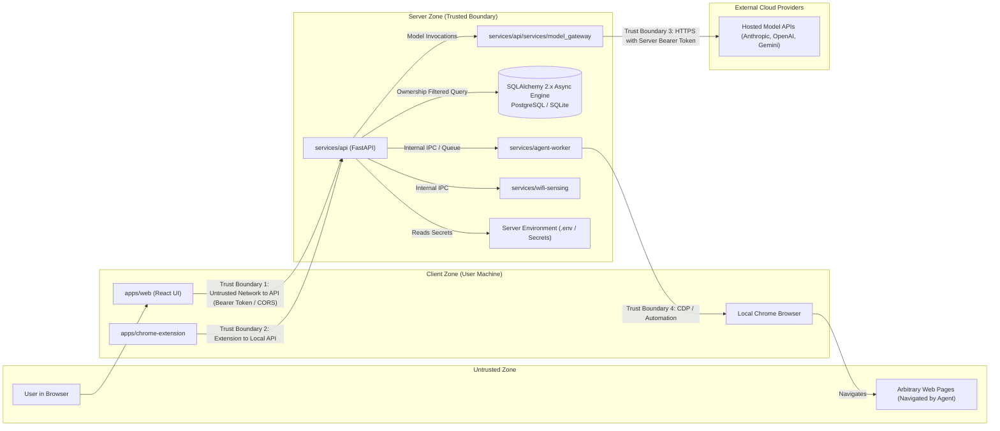

# Unified AI Assistant — Security Threat Model

## 1. Scope & Objective

This threat model identifies potential risks, trust boundaries, attack vectors, and required mitigations for the **Unified AI Assistant**, covering the conversational interface, persistence database layer, unified model gateway, autonomous browser agent, background workers, and Wi-Fi sensing integration.

---

## 2. Trust Boundaries & Data Flow

---

## 3. STRIDE Threat Analysis

### 3.1. Spoofing
| Threat | Target | Risk | Mitigation |
| :--- | :--- | :--- | :--- |
| Client requests impersonate user sessions or bypass auth | API Gateway (`services/api`) | High | Session tokens / JWT, HTTPS enforcement, strict CORS configuration limiting access to authorized frontend origins. |
| Malicious script impersonates Chrome extension messages | Chrome Extension bridge | High | Manifest V3 message validation, strict origin checking, one-time shared secret handshake between API and extension. |
| Cross-tenant conversation hijacking or spoofed user IDs | Database API (`/api/conversations/*`, `/api/tasks/*`, `/api/calendar/*`, `/api/reminders/*`) | High | **Identity Boundary**: Request dependency extracts identity from verified bearer token or dev boundary; client-supplied `owner_id` parameters in request bodies are ignored. Cross-user access returns HTTP 404 (preventing user enumeration and resource tampering). |

### 3.2. Tampering
| Threat | Target | Risk | Mitigation |
| :--- | :--- | :--- | :--- |
| SQL Injection in conversation CRUD or search | Database Engine | Critical | **Parameterized Queries**: All queries execute exclusively via SQLAlchemy 2.x parameterized statements and ORM mappings. Zero string interpolation in SQL clauses. |
| Untrusted web page injects malicious commands into browser agent | Agent Worker (`services/agent-worker`) | Critical | **Indirect Prompt Injection Defense**: Extracted DOM text is treated as untrusted and scrubbed (`prompt_defense.py`); injection heuristics detect override patterns ("ignore previous instructions"); system prompt and goal cannot be modified by page content; action allowlist strictly blocks unapproved actions; post-navigation redirect revalidation blocks malicious escapes. |
| Malicious website tricks agent into unauthorized consequential actions | Agent Worker / Browser | Critical | **Consequential Action Confirmation Gates**: Deterministic policy heuristic detects financial transactions, account deletions, message submissions, and credential entry, pausing execution for explicit operator confirmation with target and reason display. |
| Untrusted natural language prompt attempts automated unauthorized event creation | Task & Calendar Engine (`/api/tasks/extract`) | High | **Mandatory Human-in-the-Loop Confirmation**: Extraction endpoints generate structured proposals only (`requires_confirmation: true`). Zero automated database persistence from raw model output. The user must explicitly inspect and confirm extracted tasks/events in the UI before they are stored. |
| In-flight tampering of simulated CSI data streams | Wi-Fi Sensing Service | Low | Internal loopback or authenticated Unix socket/named pipe communication only. |

### 3.3. Repudiation
| Threat | Target | Risk | Mitigation |
| :--- | :--- | :--- | :--- |
| User denies initiating autonomous web transaction or message deletion | Audit Trail | Medium | Structured audit log of all browser agent actions, user confirmations, and LLM tool invocations with UTC timestamps. |
| Disputed conversation modifications or message deletions | Database History | Low | Timestamped database records (`created_at`, `updated_at`) with foreign key cascade constraints. |

### 3.4. Information Disclosure
| Threat | Target | Risk | Mitigation |
| :--- | :--- | :--- | :--- |
| Model API keys exposed to frontend client or source control | Hosted AI Provider Credentials | Critical | **Zero-Client-Key Architecture**: Frontend code contains no API keys. All keys loaded via server-side environment variables only. Strict `.gitignore` prevents secret commits. |
| Database connection string exposed to client | Database Configuration | High | `DATABASE_URL` is read exclusively on the server. No client-accessible API exposes database credentials. |
| Secrets or chain-of-thought leaked into database messages | Message Persistence | High | Conversation records store only public role (`user`, `assistant`), scrubbed content, and sanitized provider/model identifiers. Raw request headers, auth tokens, and internal provider payloads are strictly excluded. |
| Sensitive personal data extracted from browser during autonomous tasks | Browser DOM / Cookies | High | Ephemeral browsing sessions for cloud runs; for local Chrome, mask password fields, prevent exfiltration of session cookies, and prompt before accessing credentials. |
| Wi-Fi sensing exposing detailed location or intimate physical state | Wi-Fi CSI Telemetry | Medium | Provide only coarse presence flags (Present/Empty/Active); do not record or stream raw RF waveform data beyond the local sensing process. |

### 3.5. Denial of Service
| Threat | Target | Risk | Mitigation |
| :--- | :--- | :--- | :--- |
| Excessive database query loads or expensive full-text scans | Database Engine | Medium | Enforced pagination limits (`limit=50` max), indexed foreign keys (`conversation_id`, `task_id`, `event_id`), and indexed search/filter columns (`title`, `content`, `status`, `due_date`, `start_time`). |
| Unbounded recurrence expansion DOS in calendar queries | Calendar Service | High | **Bounded RRULE Evaluation**: Enforced maximum occurrences limit (`max_occurrences <= 50`), maximum time horizon (1 year max from window start), and rejection of infinite recurrence rules without bounded counts or endpoints. |
| Infinite loops or resource exhaustion in browser automation | Agent Worker | High | Per-task execution timeout (e.g., 5 minutes max), maximum step count (e.g., 25 steps), and concurrent execution limits. |
| Uncontrolled LLM streaming consuming excessive API credits | API Gateway | High | Server-enforced rate limiting, token usage quotas, and prompt length caps. |

### 3.6. Elevation of Privilege
| Threat | Target | Risk | Mitigation |
| :--- | :--- | :--- | :--- |
| Browser agent escapes sandbox and accesses local files | Host Operating System | Critical | When executing in cloud mode, run within unprivileged Docker containers with dropped capabilities. When local, restrict CDP commands to browser viewport and disallow arbitrary file protocol (`file:///`) navigation unless explicitly permitted by the user. |
| Server-Side Request Forgery (SSRF) via Browser Agent | Internal Networks & Cloud Metadata | Critical | Egress firewall rules blocking access to RFC 1918 private subnets and cloud metadata endpoints (`169.254.169.254`). |

### 3.7. Files & Knowledge Engine Threats (Phase 5)
| Threat | Target | Risk | Mitigation |
| :--- | :--- | :--- | :--- |
| Path-traversal in file uploads (`../../etc/passwd`) | Server Filesystem | Critical | Strict sanitization of filenames via `Path(filename).name`, sandboxed directory trees (`data/storage/{owner_hash}/`), and absence of public static routes. |
| Executable binaries or disguised malware uploads | Server Execution Environment | High | Format allowlist (PDF, DOCX, TXT, MD, CSV, Code/JSON) combined with magic byte verification (`%PDF-`, `PK\x03\x04`). Unsupported files rejected with 400 Bad Request. |
| Storage exhaustion DOS attacks | Disk Storage & Database | High | 20 MB per-file limit, 100 MB aggregate user quota, 50 file count limit, and 2,000,000 char extraction cap. Content SHA-256 deduplication reuses disk files for identical uploads. |
| Prompt injection via untrusted document content | LLM Gateway / RAG Agent | High | Document text is strictly formatted as untrusted reference data with explicit system guardrails prohibiting the model from obeying instructions embedded inside document context. |
| Cross-tenant document or chunk leakage | Document & Vector Index | Critical | Tenant isolation enforced at database query level (`owner_id` filtering on both `FileRecord` and `DocumentChunk`). Cross-tenant requests return 404 to avoid enumeration. |
| Internal path leakage in extraction errors | Error Responses | Low | Extraction and processing errors are sanitized to remove server filesystem paths before persistence or API serialization. |

---

## 4. Key Security Invariants

1. **Server-Side API Key Storage**: No external model provider key (`OPENAI_API_KEY`, `ANTHROPIC_API_KEY`, `GEMINI_API_KEY`) is ever sent to the browser or embedded in client assets.
2. **Strict Ownership Boundaries**: Every conversation query, file record, document chunk, and message search enforces user ownership. Cross-user attempts return HTTP 404 to eliminate enumeration vectors.
3. **Database Parameterization & Migrations**: Schema alterations are governed exclusively by audited Alembic migrations. Runtime schema mutations and raw unescaped SQL are prohibited.
4. **Human-in-the-Loop Safeguards**: High-risk browser actions (form submissions with payment or credential indicators, deletions, email sending) require explicit user consent via the UI.
5. **Network Boundary Segregation**: Background worker services (`services/agent-worker`, `services/wifi-sensing`) do not expose public ports directly; all traffic flows through the authenticated API gateway.
6. **Untrusted Document Boundaries**: Extracted document content is never executed as shell commands, scripts, or instructions. Evidence must be cited with verified provenance `[Doc: filename, Page X]`.

---

## 7. Phase 6 Web Research & Browser Intelligence Threat Analysis

| Threat & STRIDE Category | Attack Scenario | Implemented Mitigation & Security Control |
| :--- | :--- | :--- |
| **SSRF / Egress Violation** *(Information Disclosure / Elevation of Privilege)* | Target URL or HTTP 302/301 redirect points to loopback (`127.0.0.1`), AWS/GCP metadata (`169.254.169.254`), or private subnets (`10.0.0.0/8`, `192.168.0.0/16`). | `validate_url` performs IP resolution and blocks loopback, private ranges, link-local, and cloud metadata. `WebCollector` re-validates the destination URL after any browser redirects before extracting DOM content. |
| **Indirect Prompt Injection** *(Tampering / Elevation of Privilege)* | Untrusted third-party web pages contain hidden adversarial instructions attempting to hijack assistant behavior or exfiltrate private data. | `sanitize_page_text` strips control characters and truncates length. `detect_prompt_injection` flags heuristic override patterns. Flagged sources are tagged `flagged_injection`, prepended with security advisories, and the synthesizer prompt enforces that evidence is untrusted data, never instructions. |
| **Cross-Tenant Knowledge Leakage** *(Information Disclosure)* | User A attempts to correlate web research against User B's private uploaded documents by passing foreign `file_ids`. | `ResearchJobService.create_job` verifies file ownership against `FileRecord.owner_id`. Unauthorized documents are rejected with HTTP 400. All knowledge searches and file fetches strictly filter by authenticated `owner_id`. |
| **Resource Exhaustion / Malicious Payloads** *(Denial of Service)* | Discovered links point to multi-gigabyte ISOs, archives, or streaming endpoints designed to freeze the browser worker. | `WebCollector` verifies HTTP `Content-Type` (`text/html` or `text/plain` only), sets strict navigation timeouts (15s), and limits extracted text length to 15,000 characters. |
| **Session & State Contamination** *(Information Disclosure)* | Third-party cookies, tracking tokens, or session state persist across research jobs or identities. | Playwright worker executes within fresh ephemeral `BrowserContext` instances. No session storage, cookies, or browser profiles persist between collection runs. |

---

## 8. Phase 7 Wi-Fi Sensing Service Threat Analysis

| Threat & STRIDE Category | Attack Scenario | Implemented Mitigation & Security Control |
| :--- | :--- | :--- |
| **Authenticity Spoofing** *(Spoofing / Tampering)* | Service or malicious actor claims synthetic observations are real physical humans, or fakes a physical CSI hardware connection. | Every simulated observation is immutably tagged with `is_simulated = True` and `sensor_type = "synthetic_csi"`. Hardware adapter explicitly verifies physical NIC and driver capabilities, honestly returning `is_available: False` when unsupported. UI presents persistent `SIMULATION MODE ACTIVE` badge. |
| **Unconsented Surveillance** *(Information Disclosure)* | Sensing is activated in an unauthorized zone without explicit operator consent. | Every sensing zone mandates explicit authorization (`is_authorized: True`) prior to session start. Starting an unauthorized room returns HTTP 400 (`Consent required`). De-authorizing a room immediately halts active sessions. |
| **Passive Biometric Identification** *(Information Disclosure)* | Estimator or assistant attempts to de-anonymize or identify specific individuals from RF perturbation patterns. | Sensing model is restricted strictly to non-identifying disturbance metrics (subcarrier variance, Doppler proxy, RSSI). The assistant tool prompt and presence estimator explicitly prohibit personal identification, facial/gait recognition, or demographic inference. |
| **Cross-Tenant Telemetry Leakage** *(Information Disclosure)* | Tenant B queries, modifies, starts, or deletes Tenant A's room configs or time-series events. | Database queries enforce strict `owner_id == authenticated_user_id` filtering on `wifi_sensor_configs`, `wifi_sensing_events`, and `wifi_sensing_audits`. Cross-tenant resource lookups return HTTP 404. |
| **Silent Background Execution** *(Denial of Service / Privacy)* | Sensing runs indefinitely in the background without user awareness. | Dashboard visibly indicates active simulations. Session status endpoints detail active room counts. In-memory simulators require explicit start commands and support immediate reset. |
| **Retention Violation** *(Information Disclosure)* | Sensitive historical occupancy trends remain stored indefinitely on disk. | Configurable per-zone retention windows (`retention_days`, default 7 days) with automated cutoff purging. Users can trigger immediate manual history purges via `DELETE /api/sensing/events`. |
| **External AI Telemetry Exfiltration** *(Information Disclosure)* | Raw high-frequency CSI packets or subcarrier metrics are transmitted to third-party AI models. | Raw CSI arrays are kept strictly local. Only high-level aggregated occupancy status is shared with the assistant when explicitly requested via `use_sensing=True`, bound by privacy rules. |

---

## 9. Phase 8 Production Hardening & Cloud Browser Threat Analysis

| Threat & STRIDE Category | Attack Scenario | Implemented Mitigation & Security Control |
| :--- | :--- | :--- |
| **Subresource SSRF / Cloud Metadata Pivoting** *(Elevation of Privilege / Information Disclosure)* | A rendered web page includes malicious subresources (``, `<iframe src="http://127.0.0.1:8000/">`, or decimal/octal/hex IP evasions) attempting to steal IAM instance credentials or access private internal cluster APIs. | Two-tier defense: 1) `validate_url` performs comprehensive scheme allowlisting, standard web port enforcement (80, 443, 8080), explicit cloud metadata blocking, decimal/octal/hex IP normalization, and DNS lookup checks. 2) Playwright browser route interception (`context.route('**/*')`) validates every outbound egress request at the browser process level, aborting prohibited targets with `route.abort('blockedbyclient')`. |
| **Identity Spoofing & Authentication Bypass** *(Spoofing / Elevation of Privilege)* | An unauthenticated attacker sends arbitrary bearer strings or `X-User-Id: admin` headers to access other users' conversations, files, or browser tasks in production. | Fail-closed authentication architecture: In production (`IS_PRODUCTION=true` or `ALLOW_DEV_AUTH=false`), all requests must present a valid cryptographically signed HMAC-SHA256 JWT access token. Signatures are verified using constant-time comparison (`hmac.compare_digest`). Tokens with expired lifetimes, tampered signatures, or mismatched audience/issuer claims are rejected with HTTP 401 Unauthorized. User spoofing headers are completely ignored. |
| **Duplicate Job Claiming & Race Conditions** *(Tampering / Denial of Service)* | Multiple worker nodes simultaneously query and claim the same browser task or research job, leading to duplicate browser sessions, wasted compute, and corrupt task evidence. | Atomic conditional SQL claiming: Workers acquire task execution leases via an atomic `UPDATE ... WHERE id = :id AND (claimed_by_worker IS NULL OR claimed_by_worker = :worker_id)` conditional statement. If another worker already claimed the task, the statement updates zero rows and the worker immediately bails out. |
| **Request Flooding & Buffer Exhaustion** *(Denial of Service)* | Attackers transmit gigabyte-scale payloads or rapid bursts of requests to overwhelm memory and worker threads. | 1) `PayloadSizeLimitMiddleware` inspects `Content-Length` and rejects bodies exceeding 15 MB with HTTP 413. 2) `RateLimitingMiddleware` enforces a sliding-window rate limit (120 req/min per IP/identity), returning HTTP 429 with `Retry-After` headers for excessive traffic. |
| **Credential / Token Leakage in Observability Logs** *(Information Disclosure)* | Bearer tokens, OpenAI/Anthropic/Gemini API keys, or database credentials are leaked into centralized logging sinks (Datadog, CloudWatch, Loki) during error traces. | `SecretRedactionFilter` is configured on root logging handlers. All log messages, format strings, and dictionary arguments are automatically scrubbed against high-entropy regex patterns matching Bearer tokens, OpenAI (`sk-...`), Google AI (`AIza...`), Anthropic (`sk-ant-...`), and password query parameters before output. |
| **Container Privilege Escalation & Host Escape** *(Elevation of Privilege)* | Compromised Chromium process exploits an OS vulnerability to break out into the host container. | Multi-stage Dockerfiles create dedicated non-root users (`appuser` in API, `workeruser` in worker, uid 10001). Containers run with dropped capabilities and isolated internal Docker bridge networks (`backend-net`) preventing direct external ingress to the persistence tier. |

