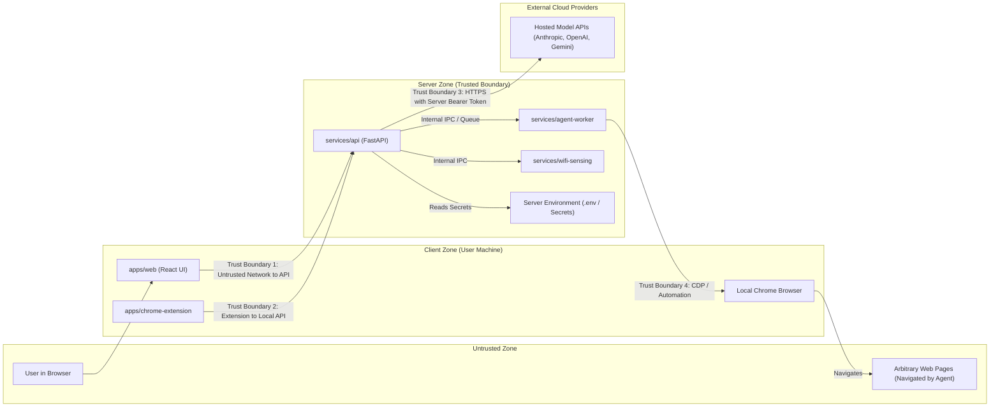

# Unified AI Assistant — Security Threat Model

## 1. Scope & Objective

This threat model identifies potential risks, trust boundaries, attack vectors, and required mitigations for the **Unified AI Assistant**, covering the conversational interface, autonomous browser agent, background workers, and Wi-Fi sensing integration.

---

## 2. Trust Boundaries & Data Flow

---

## 3. STRIDE Threat Analysis

### 3.1. Spoofing
| Threat | Target | Risk | Mitigation |
| :--- | :--- | :--- | :--- |
| Client requests impersonate user sessions or bypass auth | API Gateway (`services/api`) | High | Session tokens / JWT, HTTPS enforcement, strict CORS configuration limiting access to authorized frontend origins. |
| Malicious script impersonates Chrome extension messages | Chrome Extension bridge | High | Manifest V3 message validation, strict origin checking, one-time shared secret handshake between API and extension. |

### 3.2. Tampering
| Threat | Target | Risk | Mitigation |
| :--- | :--- | :--- | :--- |
| Untrusted web page injects malicious commands into browser agent | Agent Worker (`services/agent-worker`) | Critical | **Indirect Prompt Injection defense**: Segregate system instructions from untrusted DOM text; require explicit user approval for destructive/financial actions. |
| In-flight tampering of simulated CSI data streams | Wi-Fi Sensing Service | Low | Internal loopback or authenticated Unix socket/named pipe communication only. |

### 3.3. Repudiation
| Threat | Target | Risk | Mitigation |
| :--- | :--- | :--- | :--- |
| User denies initiating autonomous web transaction or message deletion | Audit Trail | Medium | Structured audit log of all browser agent actions, user confirmations, and LLM tool invocations with UTC timestamps. |

### 3.4. Information Disclosure
| Threat | Target | Risk | Mitigation |
| :--- | :--- | :--- | :--- |
| Model API keys exposed to frontend client or source control | Hosted AI Provider Credentials | Critical | **Zero-Client-Key Architecture**: Frontend code contains no API keys. All keys loaded via server-side environment variables only. Strict `.gitignore` prevents secret commits. |
| Sensitive personal data extracted from browser during autonomous tasks | Browser DOM / Cookies | High | Ephemeral browsing sessions for cloud runs; for local Chrome, mask password fields, prevent exfiltration of session cookies, and prompt before accessing credentials. |
| Wi-Fi sensing exposing detailed location or intimate physical state | Wi-Fi CSI Telemetry | Medium | Provide only coarse presence flags (Present/Empty/Active); do not record or stream raw RF waveform data beyond the local sensing process. |

### 3.5. Denial of Service
| Threat | Target | Risk | Mitigation |
| :--- | :--- | :--- | :--- |
| Infinite loops or resource exhaustion in browser automation | Agent Worker | High | Per-task execution timeout (e.g., 5 minutes max), maximum step count (e.g., 25 steps), and concurrent execution limits. |
| Uncontrolled LLM streaming consuming excessive API credits | API Gateway | High | Server-enforced rate limiting, token usage quotas, and prompt length caps. |

### 3.6. Elevation of Privilege
| Threat | Target | Risk | Mitigation |
| :--- | :--- | :--- | :--- |
| Browser agent escapes sandbox and accesses local files | Host Operating System | Critical | When executing in cloud mode, run within unprivileged Docker containers with dropped capabilities. When local, restrict CDP commands to browser viewport and disallow arbitrary file protocol (`file:///`) navigation unless explicitly permitted by the user. |
| Server-Side Request Forgery (SSRF) via Browser Agent | Internal Networks & Cloud Metadata | Critical | Egress firewall rules blocking access to RFC 1918 private subnets and cloud metadata endpoints (`169.254.169.254`). |

---

## 4. Key Security Invariants

1. **Server-Side API Key Storage**: No external model provider key (`OPENAI_API_KEY`, `ANTHROPIC_API_KEY`, `GEMINI_API_KEY`) is ever sent to the browser or embedded in client assets.
2. **Human-in-the-Loop Safeguards**: High-risk browser actions (form submissions with payment or credential indicators, deletions, email sending) require explicit user consent via the UI.
3. **Network Boundary Segregation**: Background worker services (`services/agent-worker`, `services/wifi-sensing`) do not expose public ports directly; all traffic flows through the authenticated API gateway.
4. **Least Privilege Chrome Extension**: Chrome extension permissions are limited strictly to active tab inspection and WebSocket communication with the local loopback server.
